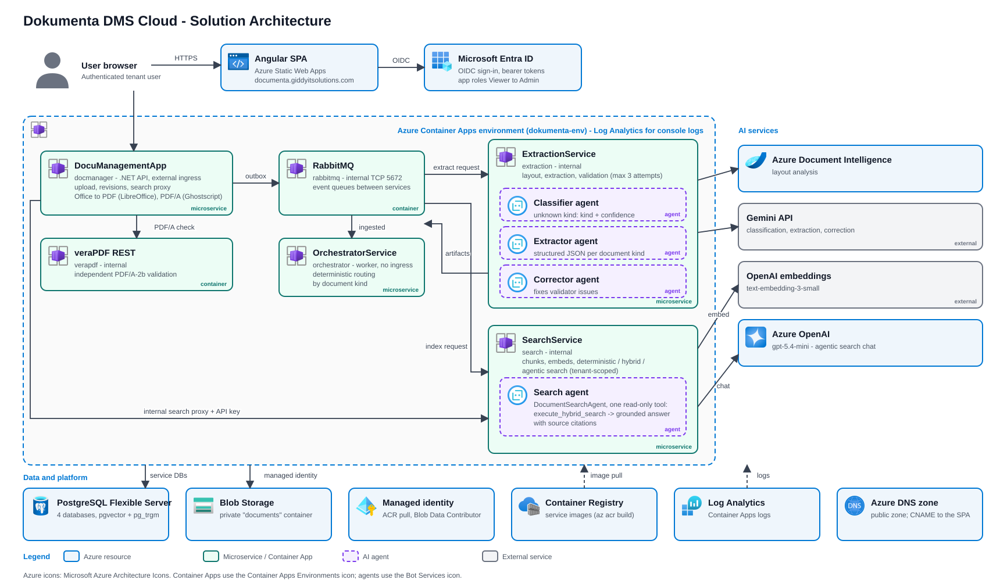
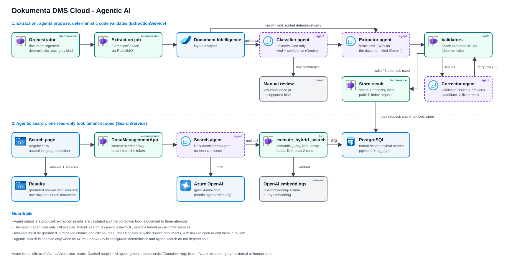

# Dokumenta DMS Cloud

Dokumenta DMS is a cloud-hosted, multi-tenant document management system. It provides authenticated document upload and storage, processing and extraction, tenant-scoped search, and versioned document revisions. The application is built with Angular, .NET, PostgreSQL, Azure services, and asynchronous workers.

## Current cloud deployment

The production architecture is hosted on Azure:

- **Web application:** Angular SPA on Azure Static Web Apps.
- **API and workers:** .NET services on Azure Container Apps.
- **Data and messaging:** Azure Database for PostgreSQL Flexible Server, private Azure Blob Storage, and an internal RabbitMQ Container App.
- **Identity:** Microsoft Entra ID using OIDC, bearer tokens, and application roles.
- **Delivery:** GitHub Actions builds and deploys the frontend and backend; Terraform provisions Azure resources. Bicep is also provided as an alternative IaC definition.

The checked-in frontend environment currently points to the generated Static Web Apps host and the `docmanager` Container App API.

The production frontend workflow takes `API_URL` and `SPA_REDIRECT_URI` from the GitHub Actions environment, so those values determine the deployed frontend configuration. 

## Solution Architecture



### Azure resources

The infrastructure definitions in [`infra/terraform/`](./infra/terraform/) and [`infra/main.bicep`](./infra/main.bicep) provision or configure:

- Azure Container Registry and a user-assigned managed identity for image pulls and Blob Storage access.
- An Azure Container Apps environment, an externally reachable `docmanager` API, internal `extraction` and `search` apps, a worker `orchestrator`, internal RabbitMQ, and an internal `verapdf` validator app.
- Azure Database for PostgreSQL Flexible Server with separate databases for the API, orchestration, extraction, and search. The server enables the `vector` and `pg_trgm` extensions.
- An Azure Storage account with a private `documents` container; public Blob access and shared-key access are disabled.
- Azure Static Web Apps, Log Analytics, and an Azure DNS public zone for `giddyitsolutions.com`.

The Static Web App custom hostname `documenta.giddyitsolutions.com` is attached by both Terraform and Bicep using CNAME-delegation validation. Terraform imports the existing Azure custom-domain binding into state on the next apply. The IaC also creates an Azure DNS zone and outputs its name servers, but the domain is currently hosted outside Azure DNS. Until the parent domain is delegated to those name servers, create a CNAME record named `documenta` in the active DNS provider pointing to the Static Web App's default hostname. Azure must be able to resolve that CNAME during custom-domain validation; HTTPS is provisioned after validation. The API CORS configuration allows both the generated Static Web Apps hostname and the custom hostname.

The PostgreSQL server currently has public network access enabled with the Azure-services firewall rule. Restricting database access through private networking is a production-hardening item.

## Backend services

| Service | Azure runtime | Responsibility | Database |
|---|---|---|---|
| `DocuManagementApp` | Public Azure Container App API | Entra authentication and role checks; tenant-scoped upload, listing, downloads, storage, revisions, search proxy, and Office-to-PDF / PDF/A conversion (image built with LibreOffice and Ghostscript; sized at 1 vCPU / 2 GiB). | `documanagementdb` |
| `OrchestratorService` | Background worker, no external ingress | Consumes document-ingested events, classifies known document types using metadata, and dispatches extraction jobs. It does not use an LLM to route documents. | `orchestratordb` |
| `ExtractionService` | Internal Azure Container App | Retrieves document content through the API, runs layout and model extraction, validates results, and publishes artifacts and indexing requests. | `extractiondb` |
| `SearchService` | Internal Azure Container App | Consumes indexing requests, chunks and embeds artifacts, and serves deterministic, hybrid, and agentic search to the API. | `searchdb` |

RabbitMQ is an internal Container App used for the asynchronous event flow. `verapdf` (the `verapdf/rest` image) is an internal Container App that independently validates PDF/A output for the API. The API is the only backend service with public ingress; service-to-service calls use internal endpoints and configured API keys.

## Application capabilities

- **Document management:** authenticated upload, listing, download, conversion endpoints, and document metadata.
- **Private file storage:** documents are stored in Blob Storage in Azure; local development can use the local configuration.
- **Revisions:** view revision history, save edited revisions, and restore earlier versions.
- **Asynchronous processing:** transactional outboxes and RabbitMQ queues decouple ingestion, orchestration, extraction, and indexing.
- **Classification and extraction:** rule-based classification routes known document types. Azure Document Intelligence produces layout text; an LLM can classify unknown document kinds and extract or correct structured data with validators.
- **Search:** deterministic filters, hybrid semantic search, and optional agentic search. Search chunks and vectors are stored in PostgreSQL rather than Azure AI Search. The UI lists each matching source document once (best-scoring hit) with links to open the original or edit it in the revision review; chunk text is not shown.
- **PDF workflows:** Office-to-PDF uses LibreOffice and PDF/A-2b conversion uses Ghostscript, both installed in the `docmanager` image (`WITH_OFFICE_TOOLS=true`, set by `deploy-backend.yml`). Output is only accepted when the `verapdf` app reports compliance. Locally, the services fall back to a Podman/Docker container if the tools are not installed; see [PDF-A-SETUP.md](./DocuManagementApp/PDF-A-SETUP.md).

## Tenant isolation and authorization

The API derives ownership from the authenticated Entra token; clients do not choose a tenant key in request data.

- Work or school identities are scoped to their Entra tenant (`tid`).
- Personal Microsoft accounts are scoped to the individual account (`oid`, with a hashed `sub` fallback), rather than sharing a single personal-account tenant.
- Document reads, downloads, revisions, and search are tenant-filtered. A document without a trusted tenant owner is not exposed as shared data.
- The API enforces the `Viewer`, `Contributor`, `Reviewer`, and `Admin` application roles through the `DmsRead`, `DmsWrite`, `DmsReview`, and `DmsAdmin` policies.

Legacy documents that have no tenant ownership must be assigned through a trusted migration before they can be accessed under tenant isolation.

## AI and search configuration

- **Extraction:** the cloud IaC configures Azure Document Intelligence and Gemini. API keys are supplied through deployment secrets, not committed configuration.
- **Embeddings:** SearchService uses OpenAI-compatible embeddings; the deployment defaults to `text-embedding-3-small`.
- **Agentic search:** SearchService uses an Azure OpenAI chat deployment configured as `gpt-5.4-mini` with API version `2024-12-01-preview`. It can call the hybrid-search tool, but cannot select a tenant or access arbitrary services. The feature remains disabled unless `TF_AGENTIC_SEARCH_API_KEY` is available to the Terraform deployment.
- **Grounding:** agent answers are based on retrieved document chunks and include source citations. Search requests remain scoped to the caller's tenant.

Keep all API keys and passwords in GitHub Actions secrets, Azure Container App secrets, or local user secrets. Terraform's remote state can contain secret values and must be access-controlled.

## Agentic AI

The system keeps deterministic decisions in application code and uses LLM agents for language understanding. Agent output is treated as a proposal: extraction results pass through validation, and the search agent can only call a constrained read-only search tool.



### Extraction agents

The cloud extraction flow uses Azure Document Intelligence for layout analysis and Gemini for model-based tasks:

| Agent | Role |
|---|---|
| Classifier | For an unknown kind, proposes a supported kind and confidence from extracted document text. |
| Extractor | Produces structured JSON for the selected document kind. |
| Corrector | Uses validation issues and the previous candidate to propose a corrected result. |

Known kinds are routed deterministically from document metadata. Low-confidence or unsupported classifications are sent for manual review rather than guessed. Validators check extracted JSON; the generate/validate/correct loop is bounded to three attempts. The result status and artifacts are stored, and an indexing request is published for SearchService.

### Agentic search

For `/api/search/agentic`, `DocumentSearchAgent` turns a natural-language question into a call to the single `execute_hybrid_search` tool. The tool can use a semantic query and supported document filters; it cannot select a tenant, issue SQL, or call arbitrary services.

- Supported tool inputs include `semanticQuery`, `documentKind`, `entityName`, `dateFrom`, `dateTo`, and `limit`.
- Relative date phrases are converted to date filters using the request's current date.
- The default tool-call budget is two (configurable from one to five).
- Answers must be grounded in retrieved chunks, cite the source URL and page when available, and stay within two sentences. If no results match, the agent reports that no matching documents were found.
- The search tool is tenant-scoped using the authenticated request context. The agent does not receive a tenant selector.
- The cloud chat deployment is Azure OpenAI `gpt-5.4-mini` (`2024-12-01-preview`). Agentic search is only enabled when its API key is configured; deterministic and hybrid search do not depend on that chat key.

## CI/CD and infrastructure

GitHub Actions workflows are under [`.github/workflows/`](./.github/workflows/):

- `ci.yml` restores and builds the .NET solution, runs backend tests, builds the Angular production bundle, and checks Terraform formatting and validity.
- `terraform.yml` plans infrastructure changes for pull requests and applies infrastructure from the production workflow for main-branch changes or manual runs. It authenticates to Azure using GitHub OIDC.
- `deploy-backend.yml` builds service images in Azure Container Registry (the `docmanager` image includes the Office/PDF tools), updates the Container Apps, and waits for healthy revisions.
- `deploy-frontend.yml` builds Angular with the configured API URL and SPA redirect URI, deploys to Static Web Apps, and performs a smoke test.

Use **either Terraform or Bicep** to manage a given environment, not both against the same resources. Terraform uses an Azure Storage remote state backend with Entra authentication.

## Local development

Local setup instructions are maintained in [GiddyGiddy/Document-Management-System](https://github.com/GiddyGiddy/Document-Management-System), which contains the README for local development.

## Tests and validation

```powershell
dotnet test DocuManagementApp.Tests/DocuManagementApp.Tests.csproj
cd angClientapp
npm ci
npm test
npm run build
```

Terraform can be checked without connecting to the remote backend:

```powershell
cd infra\terraform
terraform init -backend=false
terraform validate
terraform fmt -check -recursive
```

## Known gaps and follow-up work


- **PostgreSQL networking:** the current server is publicly reachable through its Azure-services firewall rule. Prefer private networking and narrower access controls for hardened production deployments.
- **Revision indexing:** saving a revision does not automatically trigger re-extraction or re-indexing.
- **Legacy ownership:** documents created before tenant ownership was added need trusted ownership mapping before they can be accessed.

