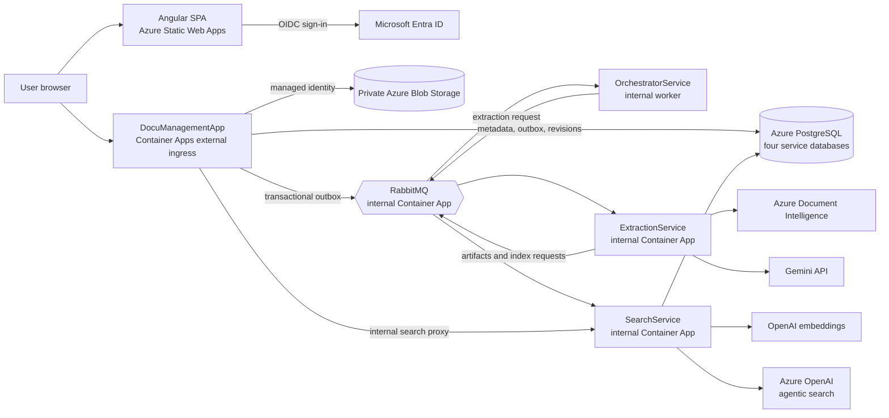

# Dokumenta DMS Cloud

Dokumenta DMS is a cloud-hosted, multi-tenant document management system. It provides authenticated document upload and storage, processing and extraction, tenant-scoped search, and versioned document revisions. The application is built with Angular, .NET, PostgreSQL, Azure services, and asynchronous workers.

## Current cloud deployment

The production architecture is hosted on Azure:

- **Web application:** Angular SPA on Azure Static Web Apps.
- **API and workers:** .NET services on Azure Container Apps.
- **Data and messaging:** Azure Database for PostgreSQL Flexible Server, private Azure Blob Storage, and an internal RabbitMQ Container App.
- **Identity:** Microsoft Entra ID using OIDC, bearer tokens, and application roles.
- **Delivery:** GitHub Actions builds and deploys the frontend and backend; Terraform provisions Azure resources. Bicep is also provided as an alternative IaC definition.

The checked-in frontend environment currently points to the generated Static Web Apps host and the `docmanager` Container App API:

- Static Web App: `https://zealous-water-0bf079110.2.azurestaticapps.net`
- API: `https://docmanager.blackdune-d31605d8.swedencentral.azurecontainerapps.io/api`

The production frontend workflow takes `API_URL` and `SPA_REDIRECT_URI` from the GitHub Actions environment, so those values determine the deployed frontend configuration. The intended custom frontend hostname is `https://dwebapp.dms-documenta.com`; DNS delegation, Static Web Apps domain binding, and the Entra redirect URI must be configured before switching to it.

## Architecture



### Azure resources

The infrastructure definitions in [`infra/terraform/`](./infra/terraform/) and [`infra/main.bicep`](./infra/main.bicep) provision or configure:

- Azure Container Registry and a user-assigned managed identity for image pulls and Blob Storage access.
- An Azure Container Apps environment, an externally reachable `docmanager` API, internal `extraction` and `search` apps, a worker `orchestrator`, and internal RabbitMQ.
- Azure Database for PostgreSQL Flexible Server with separate databases for the API, orchestration, extraction, and search. The server enables the `vector` and `pg_trgm` extensions.
- An Azure Storage account with a private `documents` container; public Blob access and shared-key access are disabled.
- Azure Static Web Apps, Log Analytics, and an Azure DNS public zone for `dms-documenta.com`.

The DNS zone is the parent domain. The Static Web App custom hostname is `dwebapp.dms-documenta.com`. The IaC outputs the zone's assigned name servers; after delegation, add the subdomain through **Static Web App → Custom domains → Add → Custom domain on Azure DNS**, selecting the `dms-documenta.com` zone and entering `dwebapp`. Azure creates the CNAME and provisions HTTPS. The API CORS configuration allows both the generated Static Web Apps hostname and the custom hostname.

The PostgreSQL server currently has public network access enabled with the Azure-services firewall rule. Restricting database access through private networking is a production-hardening item.

## Application capabilities

- **Document management:** authenticated upload, listing, download, conversion endpoints, and document metadata.
- **Private file storage:** documents are stored in Blob Storage in Azure; local development can use the local configuration.
- **Revisions:** view revision history, save edited revisions, and restore earlier versions.
- **Asynchronous processing:** transactional outboxes and RabbitMQ queues decouple ingestion, orchestration, extraction, and indexing.
- **Classification and extraction:** rule-based classification routes known document types. Azure Document Intelligence produces layout text; an LLM can classify unknown document kinds and extract or correct structured data with validators.
- **Search:** deterministic filters, hybrid semantic search, and optional agentic search. Search chunks and vectors are stored in PostgreSQL rather than Azure AI Search.
- **PDF workflows:** API endpoints exist for Office-to-PDF conversion and PDF/A conversion and validation. Their cloud runtime dependencies are not fully provisioned yet; see [Known gaps](#known-gaps-and-follow-up-work).

## Tenant isolation and authorization

The API derives ownership from the authenticated Entra token; clients do not choose a tenant key in request data.

- Work or school identities are scoped to their Entra tenant (`tid`).
- Personal Microsoft accounts are scoped to the individual account (`oid`, with a hashed `sub` fallback), rather than sharing a single personal-account tenant.
- Document reads, downloads, revisions, and search are tenant-filtered. A document without a trusted tenant owner is not exposed as shared data.
- The API enforces the `Viewer`, `Contributor`, `Reviewer`, and `Admin` application roles through the `DmsRead`, `DmsWrite`, `DmsReview`, and `DmsAdmin` policies.

Legacy documents that have no tenant ownership must be assigned through a trusted migration before they can be accessed under tenant isolation.

## AI and search configuration

- **Extraction:** the cloud IaC configures Azure Document Intelligence and Gemini. API keys are supplied through deployment secrets, not committed configuration.
- **Embeddings:** SearchService uses OpenAI-compatible embeddings; the deployment defaults to `text-embedding-3-small`.
- **Agentic search:** SearchService uses an Azure OpenAI chat deployment configured as `gpt-5.4-mini` with API version `2024-12-01-preview`. It can call the hybrid-search tool, but cannot select a tenant or access arbitrary services. The feature remains disabled unless `TF_AGENTIC_SEARCH_API_KEY` is available to the Terraform deployment.
- **Grounding:** agent answers are based on retrieved document chunks and include source citations. Search requests remain scoped to the caller's tenant.

Keep all API keys and passwords in GitHub Actions secrets, Azure Container App secrets, or local user secrets. Terraform's remote state can contain secret values and must be access-controlled.

## CI/CD and infrastructure

GitHub Actions workflows are under [`.github/workflows/`](./.github/workflows/):

- `ci.yml` restores and builds the .NET solution, runs backend tests, builds the Angular production bundle, and checks Terraform formatting and validity.
- `terraform.yml` plans infrastructure changes for pull requests and applies infrastructure from the production workflow for main-branch changes or manual runs. It authenticates to Azure using GitHub OIDC.
- `deploy-backend.yml` builds service images in Azure Container Registry, updates the Container Apps, and waits for healthy revisions.
- `deploy-frontend.yml` builds Angular with the configured API URL and SPA redirect URI, deploys to Static Web Apps, and performs a smoke test.

Use **either Terraform or Bicep** to manage a given environment, not both against the same resources. Terraform uses an Azure Storage remote state backend with Entra authentication.

## Local development

The production architecture is Azure-based, but the services can also be run locally. Local dependencies are defined in [`compose.yaml`](./compose.yaml): PostgreSQL and RabbitMQ are available by default, with an optional local Document Intelligence container under the `ai` profile.

### Prerequisites

- .NET 9 SDK and `dotnet-ef`.
- Node.js 22 and npm.
- Docker or Podman for local PostgreSQL, RabbitMQ, and optional conversion tooling.
- Entra app registration settings and service credentials for authenticated or AI-backed workflows.

### Start local dependencies

Set local-only values in an untracked `.env` file, then start PostgreSQL and RabbitMQ:

```powershell
docker compose up -d postgres rabbitmq
```

Configure local connection strings, RabbitMQ credentials, Entra settings, and any model/API keys using user secrets or environment variables. Do not copy production credentials into local configuration.

Restore and run the services from the repository root:

```powershell
dotnet restore angular_asp_core_web_api.sln
dotnet ef database update --project DocuManagementApp
dotnet run --project DocuManagementApp
dotnet run --project OrchestratorService
dotnet run --project ExtractionService
dotnet run --project SearchService
```

Run the Angular application in another terminal:

```powershell
cd angClientapp
npm ci
npm start
```

The local API defaults to `http://localhost:5176`, ExtractionService's artifact API to `http://localhost:5085`, and SearchService to `http://localhost:5190`. Local user authentication requires a matching Entra SPA redirect URI and API scope.

## Tests and validation

```powershell
dotnet test DocuManagementApp.Tests/DocuManagementApp.Tests.csproj
cd angClientapp
npm ci
npm test
npm run build
```

Terraform can be checked without connecting to the remote backend:

```powershell
cd infra\terraform
terraform init -backend=false
terraform validate
terraform fmt -check -recursive
```

## Known gaps and follow-up work

- **PDF conversion in Azure:** the API currently invokes LibreOffice and Ghostscript through a local executable or container runtime. The backend deployment workflow does not enable `WITH_OFFICE_TOOLS`, and the Container Apps IaC does not deploy a container runtime or veraPDF REST service. Configure these dependencies before relying on Office-to-PDF or PDF/A processing in the cloud.
- **Custom-domain cutover:** the intended hostname is `dwebapp.dms-documenta.com`. Complete DNS delegation and Static Web Apps domain validation, then set the Entra SPA redirect URI and GitHub `SPA_REDIRECT_URI` to `https://dwebapp.dms-documenta.com`.
- **PostgreSQL networking:** the current server is publicly reachable through its Azure-services firewall rule. Prefer private networking and narrower access controls for hardened production deployments.
- **Revision indexing:** saving a revision does not automatically trigger re-extraction or re-indexing.
- **Legacy ownership:** documents created before tenant ownership was added need trusted ownership mapping before they can be accessed.
- **Optional agentic search:** the Azure OpenAI key must be configured for Terraform before agentic search is enabled; deterministic and hybrid search remain separate endpoints.
